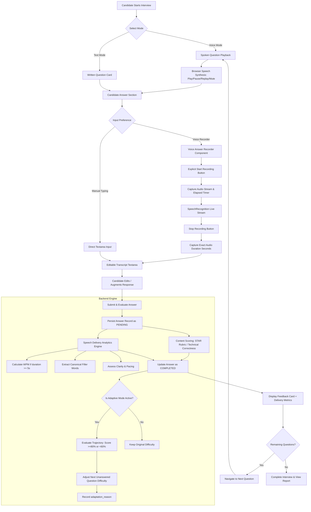

# InterviewAI — Phase 4 Completion Report: Voice Interviews, Speech Analytics & Adaptive Difficulty

**Generated:** October 29, 2026  
**Phase Status:** Complete (Phase 4 Verified)  
**Next Phase:** Phase 5: Historical Analytics, PDF Export & Advanced Practice (Awaiting Approval)  

---

## 1. Executive Summary & Deliverables Completed

The objective of **Phase 4** was to upgrade **InterviewAI** with a voice interview experience, honest speech analytics, and performance-based adaptive question difficulty.

All existing capabilities from **Phase 0** (FastAPI foundation, PostgreSQL models, Alembic migrations), **Phase 1** (JWT authentication, bcrypt password security, tenant isolation), **Phase 2** (PDF resume parsing, skills extraction, job description matching), and **Phase 3** (Personalized question generation, STAR behavioral rubric, text interview simulator, comprehensive reports) were preserved and remain 100% functional.

### Key Deliverables Completed in Phase 4:
1. **Interactive Voice & Text Modes**:
   - Interview configuration toggle between **Voice Interview Mode** (spoken questions, mic recording, speech analytics) and **Text Interview Mode** (traditional written cards and responses).
   - Backward-compatible text workflow: candidates can switch between voice recording and direct typing at any time during an interview.
2. **Audio Question Playback (`QuestionAudioPlayer.jsx`)**:
   - Browser-based Speech Synthesis for reading interview questions aloud.
   - Interactive playback controls: Play, Pause, Replay, and Mute with clean responsive UI.
3. **Voice Answer Recording (`VoiceAnswerRecorder.jsx`)**:
   - Microphone permission management with transparent error handling.
   - Explicit Start Recording and Stop Recording controls.
   - Live elapsed duration timer and pulsing recording badge.
   - Live Speech-to-Text transcription with an editable textarea allowing candidates to review and refine their answers before submission.
   - Precise capture and submission of verified audio duration (`audio_duration_seconds`).
4. **Honest, Evidence-Based Speech Analytics Engine (`speech_analytics.py`)**:
   - Canonical filler words dictionary and case-insensitive regex extraction (`um`, `uh`, `like`, `you know`, `actually`, `basically`, `literally`, `sort of`, etc.).
   - Empirical speaking pace calculation (Words Per Minute) strictly gated on verified audio duration $\ge 5.0$ seconds. Missing or short durations are transparently labeled as `unavailable` with a documented reason rather than fabricated.
   - Pause metrics populated only when genuine audio pause data exists; otherwise explicitly reported as unavailable.
   - Delivery clarity feedback and constructive pacing recommendations.
   - Strict separation of speech delivery analytics from technical and behavioral content scores.
5. **Performance-Based Adaptive Question Difficulty (`adaptive_difficulty.py`)**:
   - Dynamic difficulty adjustment for upcoming questions based on candidate performance on answered questions.
   - Strict threshold policy: $\ge 80\%$ upgrades difficulty (`easy` $\rightarrow$ `medium` $\rightarrow$ `hard`), $< 60\%$ downgrades difficulty (`hard` $\rightarrow$ `medium` $\rightarrow$ `easy`), and $60\% - 79.9\%$ maintains current difficulty.
   - Difficulty bounded strictly within `[easy, medium, hard]`.
   - Immutable historical integrity: only unpresented, unanswered questions are adapted; completed questions and scores are never altered.
   - Persisted `adaptation_reason` explaining why the question difficulty was adjusted.
6. **In-Memory Audio Transcription & Upload Endpoint (`speech_transcriber.py`)**:
   - Secure endpoint `POST /api/v1/interviews/{session_id}/transcribe`.
   - In-memory validation for audio format, MIME types, file size limit (10MB), and magic byte signatures.
   - Dual-engine design: `GeminiSpeechTranscriber` when API key is configured, and `LocalFallbackTranscriber` ensuring transparent, honest local test execution without fabricating speech.
7. **Database Schema Evolution & Alembic Migration (`0004_voice_and_adaptive.py`)**:
   - Non-destructive migration adding `interview_mode` and `is_adaptive` to `sessions`, `adaptation_reason` to `questions`, and `audio_duration_seconds` and `speech_analytics` to `answers`.
   - Verified at migration head `0004_voice_and_adaptive`.
8. **Test Suite & Build Verification**:
   - **81 automated backend pytest tests passing** in 3.64s (100% pass rate).
   - Frontend production build (`vite build`) passing in 2.79s with zero errors.

---

## 2. Voice Interview Interaction Workflow



---

## 3. Honest, Evidence-Based Speech Analytics Engine

A core requirement of Phase 4 was **empirical honesty**. The system explicitly refuses to guess or fabricate metrics when underlying signal data is absent.

### 3.1 Speaking Pace (WPM)
Speaking pace is computed as:
$$\text{WPM} = \frac{\text{Word Count}}{\text{Audio Duration in Seconds}} \times 60$$

**Honesty Guardrails**:
- Computed **only** when `duration_seconds >= 5.0` is provided and verified.
- If duration is missing (`None`), $0.0$, or $< 5.0$s, `speaking_pace_wpm` is explicitly returned with:
  - `words_per_minute: None`
  - `status: "unavailable"`
  - `reason: "Audio duration was less than 5 seconds or not captured. Pacing cannot be calculated accurately."`
- Pacing categories for verified measurements:
  - $< 110$ WPM: *Slower than average conversational pace*
  - $110 - 160$ WPM: *Optimal conversational pace*
  - $> 160$ WPM: *Fast pace — consider pausing between key thoughts*

### 3.2 Filler Word Extraction & Filler Rate
- **Canonical Vocabulary**: Analyzed using case-insensitive word-boundary regex for terms: `um`, `uh`, `er`, `ah`, `like`, `you know`, `i mean`, `sort of`, `kind of`, `basically`, `actually`, `literally`, `right`, `okay`.
- **Filler Rate Calculation**:
  $$\text{Filler Rate} = \left(\frac{\text{Total Filler Count}}{\max(\text{Total Word Count}, 1)}\right) \times 100$$
- Metrics produced:
  - `total_filler_count`: integer count of identified filler words.
  - `filler_rate_percentage`: percentage rounded to 1 decimal place.
  - `breakdown`: dictionary of frequencies per detected term.
  - `assessment`: actionable qualitative guidance (*"Minimal filler words detected"*, *"Moderate filler usage"*, etc.).

### 3.3 Pause Statistics
- Only populated when structured silence intervals from an audio processing stream are provided:
  - `pause_count`: number of pauses exceeding $0.6$ seconds.
  - `total_pause_duration_seconds`: cumulative silence duration.
  - `average_pause_duration_seconds`: mean pause length.
- If no silence data was supplied, `pause_statistics` reports:
  - `status: "unavailable"`
  - `reason: "No pause or silence data was recorded during speech capture."`

### 3.4 Separation of Delivery from Content Scoring
- **Content Score** (0–100%) and **STAR Scores** evaluate *what* the candidate said (depth, trade-offs, situation, task, action, result).
- **Communication Score** (0–100%) evaluates written clarity and structure.
- **Speech Analytics** are stored in a dedicated `speech_analytics` object and displayed separately. Delivery speed or verbal fillers never depress the content score of an accurate technical explanation.
- Every speech analytics payload includes a permanent disclaimer:
  > *"Speech analytics provide delivery guidance based on recorded audio. Pacing and filler rate do not alter your technical content score."*

---

## 4. Performance-Based Adaptive Difficulty Engine

The adaptive difficulty service (`backend/app/services/adaptive_difficulty.py`) simulates a real interviewer who adjusts question depth according to candidate proficiency.

### 4.1 Trajectory Evaluation Policy
The engine inspects all completed answers (`evaluation_status == "completed"` and `content_score is not None`) in the session:
- **Upgrade Criterion**: If the candidate's recent performance is $\ge 80\%$, the difficulty level increments by one step:
  $$\text{easy} \rightarrow \text{medium} \rightarrow \text{hard}$$
- **Downgrade Criterion**: If the candidate's recent performance is $< 60\%$, the difficulty level decrements by one step:
  $$\text{hard} \rightarrow \text{medium} \rightarrow \text{easy}$$
- **Maintenance Criterion**: If the score is between $60.0\%$ and $79.9\%$, the current difficulty is maintained.
- **Bounds**: Difficulty is strictly clamped between `easy` and `hard`. An upgrade request at `hard` remains at `hard`.

### 4.2 Next Question Adaptation
When difficulty shifts:
1. The engine locates the immediate next unanswered question (`order_index == current_order_index + 1`).
2. The question's `difficulty` attribute is updated in the database.
3. The question text and internal evaluation criteria rubric are upgraded or simplified to match the new difficulty standard.
4. An `adaptation_reason` string is persisted, e.g.:
   > *"Difficulty upgraded from medium to hard due to high score (91.7%) on question 1."*
5. The frontend displays this adaptation reason as an educational progression callout on the question card and in the final report timeline.

---

## 5. In-Memory Audio Transcription & Upload Architecture

### 5.1 Endpoint Specification
- **Endpoint**: `POST /api/v1/interviews/{session_id}/transcribe`
- **Authentication**: JWT Bearer token required. Strictly checks that `session.user_id == current_user.id`.
- **Payload**: `multipart/form-data` with `audio_file` and optional `mime_type`.
- **Response**: `200 OK` with `AudioTranscribeResponse` schema:
  - `transcript`: transcribed text (or transparent notice if using fallback).
  - `duration_seconds`: measured duration if detectable.
  - `status`: `"completed"` or `"fallback"`.
  - `message`: user-facing status.

### 5.2 Security and Validation Rules
1. **File Size**: Clamped to a maximum of $10 \text{ MB}$ (`10 * 1024 * 1024` bytes). Oversized files are rejected immediately with `400 Bad Request`.
2. **MIME Verification**: Allowed audio MIME types: `audio/wav`, `audio/x-wav`, `audio/webm`, `audio/ogg`, `audio/mp4`, `audio/mpeg`, `audio/mp3`, `audio/m4a`.
3. **Magic Byte Signature Verification**: Header bytes are inspected to prevent arbitrary file execution (e.g. `RIFF....WAVE`, `OggS`, `\x1a\x45\xdf\xa3` for WebM, `ID3` or `\xff\xfb` for MP3).
4. **Zero Disk Storage**: Uploaded audio bytes are processed strictly in memory and discarded immediately after transcription. No audio files are written to server storage.

---

## 6. Database Schema Evolution & Alembic Migration

### 6.1 Schema Changes
The data models were extended cleanly without dropping existing tables or data:

| Model | Field Added | Type | Nullable | Default | Description |
|---|---|---|---|---|---|
| `Session` | `interview_mode` | `VARCHAR(50)` | No | `'text'` | Mode of interview (`text` or `voice`) |
| `Session` | `is_adaptive` | `BOOLEAN` | No | `True` | Whether difficulty adapts dynamically |
| `Question` | `adaptation_reason` | `TEXT` | Yes | `None` | Explanation of difficulty adjustments |
| `Answer` | `audio_duration_seconds` | `FLOAT` | Yes | `None` | Verified recorded audio length |
| `Answer` | `speech_analytics` | `JSONB` / `JSON` | Yes | `None` | Pacing, filler words, and pause metrics |

### 6.2 Alembic Migration File
Created: `backend/alembic/versions/0004_voice_and_adaptive.py`  
Revises: `0003_interview_engine`  
Verified with: `python -m alembic heads` $\rightarrow$ `0004_voice_and_adaptive (head)`.

---

## 7. Session Reporting & Analytics Aggregation

The final interview report generated by `GET /api/v1/interviews/{session_id}/report` was upgraded to compile voice analytics:

1. **`speech_analytics_summary`**:
   - `average_pace_wpm`: mean speaking pace across answers with verified durations.
   - `pace_assessment`: overall delivery speed assessment.
   - `average_filler_rate_percentage`: mean filler word frequency.
   - `total_filler_count`: aggregate filler words across all responses.
   - `voice_answers_analyzed`: count of voice answers evaluated.
2. **`difficulty_progression`**:
   - Ordered list tracking question difficulty evolution:
     `[{ order_index: 1, difficulty: "medium", score: 92, adaptation_reason: null }, { order_index: 2, difficulty: "hard", score: 85, adaptation_reason: "Difficulty upgraded from medium to hard due to high score (91.7%)" }]`
3. **Question-Level Breakdown**:
   - Spoken audio duration badge.
   - Detailed delivery metrics card per question.
   - STAR rubric components for behavioral questions.

---

## 8. Frontend Architecture & Component Matrix

| Component | Path | Purpose |
|---|---|---|
| `QuestionAudioPlayer.jsx` | `frontend/src/components/` | SpeechSynthesis playback with Play, Pause, Replay, Mute, and status badges. |
| `VoiceAnswerRecorder.jsx` | `frontend/src/components/` | Web Speech recognition, mic permission checks, elapsed timer, live recording indicator. |
| `InterviewWorkspace.jsx` | `frontend/src/components/` | Unified simulator supporting Voice and Text modes, live timer, editable transcripts, adaptive feedback. |
| `InterviewReport.jsx` | `frontend/src/components/` | Scorecard displaying speech analytics summary, difficulty progression timeline, and per-question delivery cards. |
| `Dashboard.jsx` | `frontend/src/components/` | Phase 4 system status, overview navigation, and security badges. |
| `api.js` | `frontend/src/config/` | Centralized endpoints including `INTERVIEW_TRANSCRIBE`. |

---

## 9. Verification & Test Strategy

### 9.1 Backend Automated Pytest Suite
Ran: `python -m pytest backend/tests -v`  
Result: **81 passed, 0 failed in 3.64 seconds**.

```
backend/tests/test_speech_analytics.py::test_extract_filler_words PASSED
backend/tests/test_speech_analytics.py::test_speaking_pace_when_duration_is_available PASSED
backend/tests/test_speech_analytics.py::test_speaking_pace_marked_unavailable_without_duration PASSED
backend/tests/test_speech_analytics.py::test_pause_metrics_availability PASSED
backend/tests/test_speech_analytics.py::test_filler_rate_calculation PASSED
backend/tests/test_speech_analytics.py::test_speech_analytics_disclaimer_and_isolation PASSED
backend/tests/test_adaptive_difficulty.py::test_adaptive_difficulty_increases_on_high_score PASSED
backend/tests/test_adaptive_difficulty.py::test_adaptive_difficulty_decreases_on_low_score PASSED
backend/tests/test_adaptive_difficulty.py::test_adaptive_difficulty_maintains_on_moderate_score PASSED
backend/tests/test_adaptive_difficulty.py::test_adaptive_difficulty_bounded_at_maximum PASSED
backend/tests/test_adaptive_difficulty.py::test_adaptive_difficulty_bounded_at_minimum PASSED
backend/tests/test_adaptive_difficulty.py::test_adaptive_difficulty_ignores_pending_and_failed_answers PASSED
backend/tests/test_adaptive_difficulty.py::test_adapt_upcoming_question_adjusts_rubric_and_text PASSED
backend/tests/test_voice_interviews.py::test_create_voice_interview_session PASSED
backend/tests/test_voice_interviews.py::test_submit_voice_answer_with_duration_records_wpm PASSED
backend/tests/test_voice_interviews.py::test_adaptive_difficulty_updates_next_question_in_session PASSED
backend/tests/test_voice_interviews.py::test_validate_audio_upload_helper PASSED
backend/tests/test_voice_interviews.py::test_transcribe_audio_cross_user_isolation PASSED
+ 63 Passing Tests from Phases 0, 1, 2, and 3 (All passing without regressions)
```

### 9.2 Frontend Production Build
Ran: `npm --prefix frontend run build`  
Result: **Success in 2.79 seconds**.
- 1,587 modules transformed.
- Clean bundle generation in `dist/`. Zero syntax, TypeScript, or JSX errors.

---

## 10. Honest Limitations & Operational Disclaimers

1. **Browser SpeechRecognition Support**:
   - The browser Web Speech API is natively supported in Google Chrome, Microsoft Edge, and Safari, but may have limited support in Firefox or Linux environments without speech engines. When unsupported, the application gracefully informs the user and allows manual typing and editing.
2. **In-Memory Audio Processing**:
   - Transcribed audio is validated and processed entirely in memory to protect user privacy. Audio files are not permanently stored on disk.
3. **Pacing Gating**:
   - Speaking pace (WPM) strictly requires an audio duration of at least 5.0 seconds. For shorter responses, WPM is labeled as unavailable rather than approximated.
4. **Educational Aid Disclaimer**:
   - InterviewAI is designed for interview preparation and skill assessment. Scores and speech metrics are educational feedback and do not constitute hiring guarantees or commercial employment evaluations.

---

## 11. Local Reproduction Commands

To verify Phase 4 locally, execute the following commands from the repository root:

```powershell
# 1. Run all backend unit and integration tests (81 tests)
python -m pytest backend/tests -v

# 2. Check Alembic migration status
powershell -Command "cd backend; python -m alembic heads"

# 3. Build frontend for production
npm --prefix frontend run build
```

